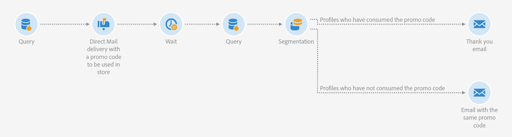

# [!UICONTROL Direct Mail] 만들기 {#create-a-direct-mail}

[!UICONTROL Direct Mail] 채널을 사용하면 에이전시로 보내거나 SFTP 서버로 업로드할 세분화된 수신자 목록을 추출할 수 있습니다.

이 비디오에서는 [!UICONTROL Direct Mail] 게재를 구성하는 방법 및 [!UICONTROL Direct Mail] 게재에 프로필을 추가하기 위해 필요한 설정을 설명합니다.

>[!VIDEO](https://video.tv.adobe.com/v/23417?learn=on){transcript=true}

## 워크플로우 내에 [!UICONTROL Direct Mail] 만들기

채널은 홈 페이지에서 워크플로우 보기 내에서 사용할 수 있으며, 통합적인 크로스 채널 마케팅 전략을 정의할 수 있습니다. 다음 예제 워크플로에는 [!UICONTROL Direct Mail activity]이(가) 포함되어 있습니다.

자세한 내용은 제품 설명서를 참조하세요. [DM 정보](https://experienceleague.adobe.com/docs/campaign-standard/using/communication-channels/direct-mail/about-direct-mail.html)
