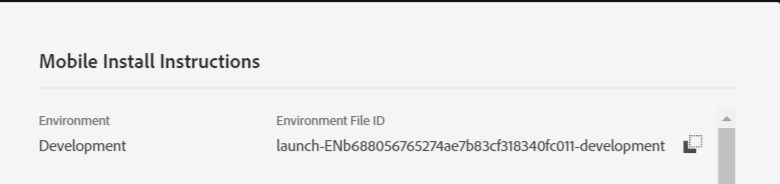

# 3단계 - 모바일 앱에 확장 등록

이 부분에서는 사용자 프로필, ID, 라이프사이클 및 신호 확장을 등록하기 위한 코드를 추가합니다. 또한 아래 코드에 표시된 대로 Adobe Campaign Standard 확장을 등록해야 합니다.

[!DNL Android] 스튜디오에서 프로젝트를 엽니다. MainApp **에서 패키지 문인 첫 번째 줄을 제외한 전체 코드를 삭제합니다**.

다음 코드를 MainApp에 붙여넣기

<!--
Removed `{.line-numbers}` below
-->

```java
import [!DNL android].app.Application;
import android.util.Log;

import com.adobe.marketing.mobile.AdobeCallback;
import com.adobe.marketing.mobile.Campaign;
import com.adobe.marketing.mobile.Identity;
import com.adobe.marketing.mobile.InvalidInitException;
import com.adobe.marketing.mobile.Lifecycle;
import com.adobe.marketing.mobile.LoggingMode;
import com.adobe.marketing.mobile.MobileCore;
import com.adobe.marketing.mobile.Signal;
import com.adobe.marketing.mobile.UserProfile;

public class MainApp extends Application {

@Override
public void onCreate() {
super.onCreate();

MobileCore.setApplication(this);
MobileCore.setLogLevel(LoggingMode.DEBUG);

try{
    Campaign.registerExtension();
    UserProfile.registerExtension();
    Identity.registerExtension();
    Lifecycle.registerExtension();
    Signal.registerExtension();
    MobileCore.start(new AdobeCallback () {
        @Override
        public void call(Object o) {
            MobileCore.configureWithAppID("copy your launch property id here");
        }
    });
} catch (InvalidInitException e) {
    Log.d("ACS Exception", "exception");
}
}
}
```

32행 [!UICONTROL  Launch] 속성의 환경 파일 ID를 제공해야 합니다. [!UICONTROL Launch] 속성의 [!UICONTROL environment tab]에서 액세스할 수 있습니다.


